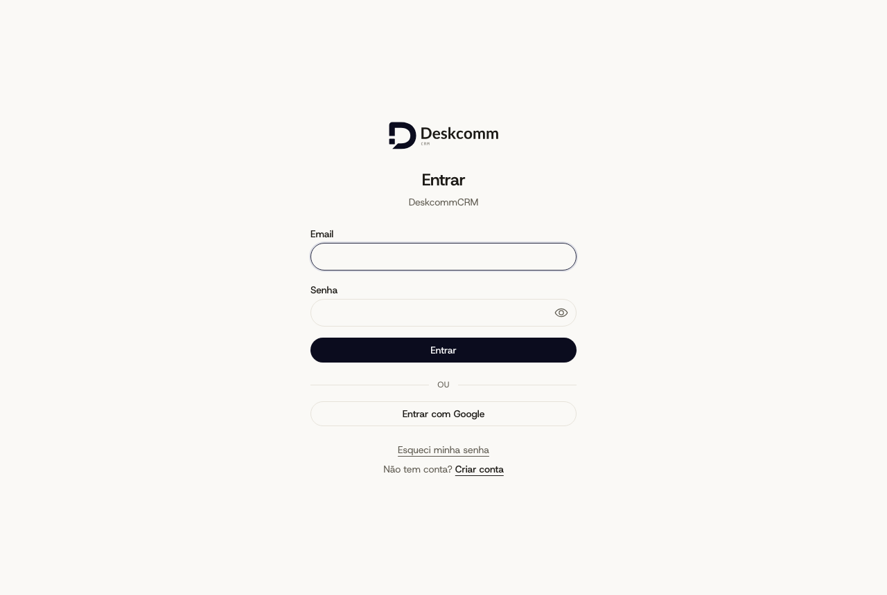
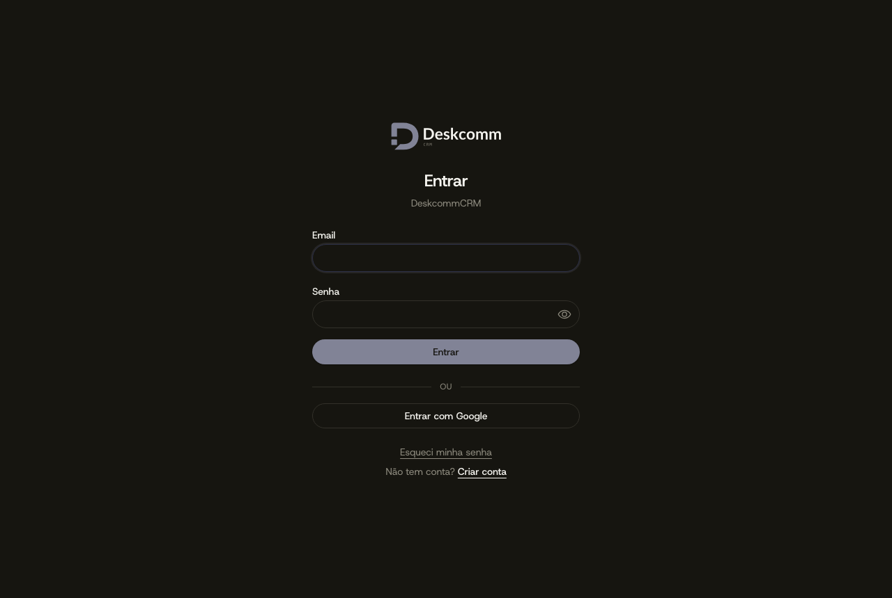

# Identidade Radar — prova pela tela (`/login`, build de produção)

Servidor: `next build` sobre `origin/producao` (v1.84.0-genuine.6) + `node .next/standalone/server.js` com env de stub (sem banco: a marca
da instalação degrada para o padrão do produto, que é o que se quer medir). Navegador:
Chromium via Playwright, 1280×860, medidas por `getComputedStyle`/`getBoundingClientRect`.

| tema   | fonte do body | `--color-accent` | botão "Entrar" (fundo / texto / raio / altura)     | campo (raio / altura) |
| ------ | ------------- | ---------------- | -------------------------------------------------- | --------------------- |
| claro  | hostGrotesk   | `#0b0c1e`        | rgb(11, 12, 30) / rgb(255, 255, 255) / 9999px / 36 | 9999px / 40           |
| escuro | hostGrotesk   | `#818396`        | rgb(129, 131, 150) / rgb(22, 21, 16) / 9999px / 36 | 9999px / 40           |

`letter-spacing` do body: −0,16px (−0,01em). `document.fonts` carregadas: só `hostGrotesk`.

Não medido aqui (sem Supabase local nesta máquina): telas autenticadas (`/app`, `/admin`),
o recorte do logo pelo campo de upload, e a camada de marca por organização.

## Capturas

