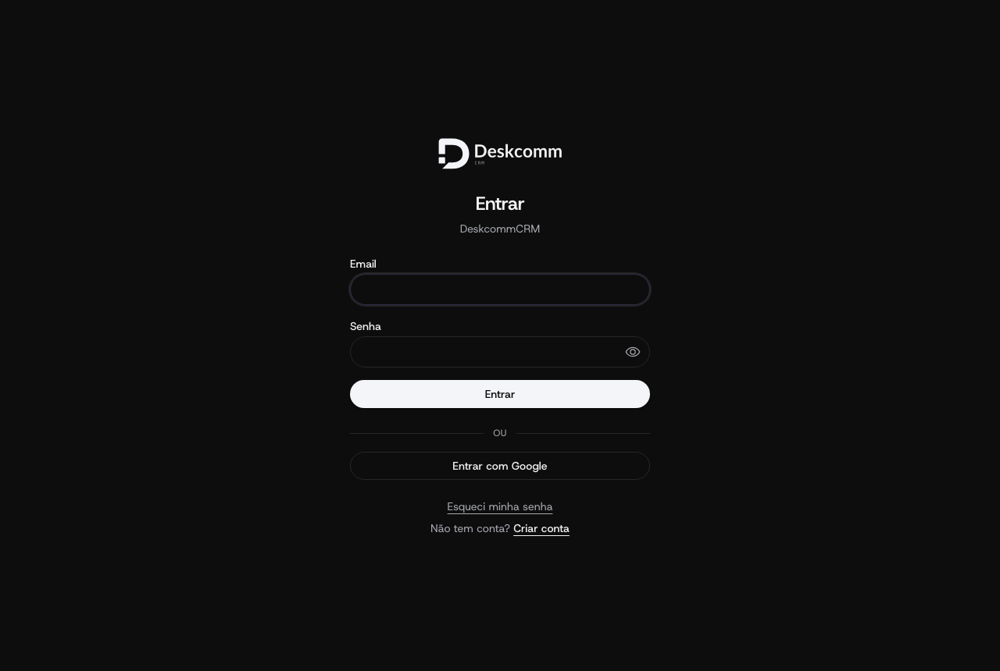
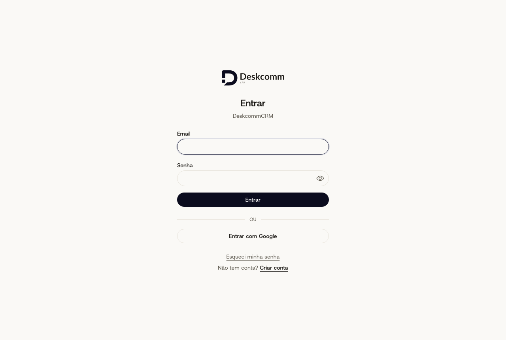

# Tema escuro Radar — prova pela tela (`/login`, build de produção)

Servidor: `next build` sobre `origin/producao` (v1.84.0-genuine.7) com este diff + `node .next/standalone/server.js`
com env de stub (sem banco: a marca da instalação degrada para o padrão do produto, que é o que se quer
medir). Navegador: Chromium via Playwright, 1280×860, medidas por `getComputedStyle`/`getBoundingClientRect`.

| tema   | `--color-bg` / `--color-surface` / `--color-surface-elevated` | `--color-border` | `--color-text` / `--color-text-muted` | `--color-accent` | botão "Entrar" (fundo / texto / raio / altura)     |
| ------ | ------------------------------------------------------------- | ---------------- | ------------------------------------- | ---------------- | -------------------------------------------------- |
| claro  | `#faf9f6` / `#fff` / `#f5f3ee`                                | `#e7e3da`        | `#1c1a16` / `#5d594f`                 | `#0b0c1e`        | rgb(11, 12, 30) / rgb(255, 255, 255) / 9999px / 36 |
| escuro | `#0d0d0e` / `#121314` / `#17181a`                             | `#26272a`        | `#f2f2f1` / `#a8aaaf`                 | `#f4f5f8`        | rgb(244, 245, 248) / rgb(10, 10, 10) / 9999px / 36 |

`body` nos dois temas: fonte `hostGrotesk` (única em `document.fonts`), `font-size` 15px, `line-height` 22,5px (1,5),
`font-weight` 400, `-webkit-font-smoothing: antialiased`, `letter-spacing: normal`. O campo mede 9999px / 40.
O tema claro é o mesmo da entrega anterior (`evidence/identidade-radar/`); só o escuro e o corpo mudaram.

Não medido aqui (sem Supabase local nesta máquina): telas autenticadas (`/app`, `/admin`) e a camada de marca
por organização.

## Capturas

